# MarketHub — multi-vendor marketplace with AI

End-of-studies project (PFE): a marketplace where **customers** buy from many independent shops in one checkout,
**sellers** run their shop from a dashboard and **admins** supervise the platform. Payment by **cash on delivery**
or **card (Stripe test mode)**. An **AI microservice** recommends products, forecasts each seller's sales, scores
the refusal risk of COD orders and writes product pages for sellers.

The storefront is built for conversion: sale prices and badges, rich product pages (tagline, key benefits, specs,
delivery window), a cart drawer with free-shipping progress and matching products, "frequently bought together"
bundles from real order history, verified-purchase reviews and a sticky buy bar. It only uses real data: no fake
countdowns, no fake scarcity.

Phase 8 made it a platform you could sell: **discount codes**, **wishlists with back-in-stock and price-drop
alerts**, a **live notification bell** (server-sent events), **abandoned-cart reminders**, **typo-tolerant instant
search** with filter counts, **review photos, helpful votes and seller replies**, **seller conversion analytics**,
**two-step sign-in, lockout and rate limiting**, an optional **Claude writer**, **meaning-based search** and **price
suggestions**, the interface in **English, French and Arabic (right-to-left)**, **Prometheus/Grafana monitoring**
and a **deployment blueprint**.

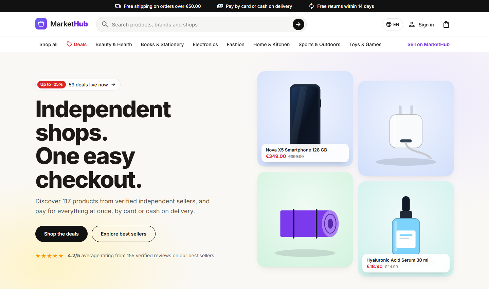

## Quick start (3 commands)

Requires Docker Desktop.

```bash
git clone <your-repo-url> markethub && cd markethub
cp .env.example .env
docker compose up --build
```

Then open:

| URL | What |
|---|---|
| http://localhost:4200 | Web app (storefront, seller center, admin console) |
| http://localhost:8080/swagger-ui.html | REST API documentation (Swagger UI) |
| http://localhost:8025 | Mailpit: every e-mail sent by the platform (order confirmations with PDF invoice…) |
| http://localhost:8000/docs | AI service API docs |
| http://localhost:3000 | Grafana dashboard, with `docker compose --profile monitoring up` (Prometheus on :9090) |

The first start builds the images and loads the demo data (~2 minutes). The AI service retrains itself on the
demo data as soon as the backend is up.

### Demo accounts

| Role | Email | Password |
|---|---|---|
| Customer | `customer1@markethub.test` (… `customer40`) | `Customer123!` |
| Seller | `seller1@markethub.test` (… `seller8`; seller 8's shop awaits validation) | `Seller123!` |
| Admin | `admin@markethub.test` | `Admin123!` |

The login page has one-click buttons for each demo role.

### Card payments

Without keys, card payments go through a built-in **simulator** (pay or simulate a declined card). To use the real
Stripe Payment Element in test mode, put your test keys in `.env` and restart:

```bash
STRIPE_SECRET_KEY=sk_test_...
STRIPE_PUBLISHABLE_KEY=pk_test_...
STRIPE_WEBHOOK_SECRET=whsec_...   # optional, for the webhook (stripe listen --forward-to localhost:8080/api/payments/stripe/webhook)
```

Test card: `4242 4242 4242 4242`, any future date, any CVC.

## Features

| Customer | Seller | Admin |
|---|---|---|
| Catalog with search, filters (category, price, rating, stock, on sale), sorting, pagination; **Deals** page | Dashboard: revenue, net after commission, orders to process, return rate, rating, charts | Platform KPIs: GMV, commission earned, orders, users, shops; charts |
| Product pages: gallery, sale price and savings, tagline, key benefits, spec sheet, delivery window, verified-purchase reviews, sticky buy bar | Product editor with sale (compare-at) price, tagline, key benefits and specs; image upload, inline stock editing, low-stock alerts | Validate, reject or suspend sellers' shops |
| **Cart drawer** with free-shipping progress and "pairs well with" suggestions; **frequently bought together** bundles; recently viewed | **AI description writer** (tagline, description, benefits, specs from a few keywords, 3 tones) and **listing quality score** | |
| Server-side cart; one checkout split into one parcel per shop | Order inbox: confirm → ship (tracking no.) → deliver, or mark refused/returned | Per-shop commission overrides, default commission, shipping rules |
| Cash on delivery or card (Stripe) | Earnings per order (commission deducted) | User management (disabling revokes sessions) |
| Order tracking per parcel, cancellation, return requests | **AI sales forecast** for the next 30 days | Category tree management |
| Reviews (only after delivery) with **photos**, **helpful votes**, star breakdown, sort and filter; **seller replies** | **AI return-risk badge** on COD orders | Returns & disputes resolution (approved returns restock and refund) |
| **AI recommendations** on the home page; **AI picks** for phrase searches | Shop profile and public shop page | **Two-step sign-in** (authenticator app) |
| **Instant search** with typo tolerance, category suggestions, **filter counts**, relevance sort | **Discount codes**: % or fixed, minimum spend, dates, usage limits, once per customer, featured on product pages | Monitoring: Prometheus metrics and Grafana dashboard |
| **Discount codes** in the cart and checkout (discount on invoices and e-mails) | **Analytics**: product page views, conversion rate, revenue, average order, returns per product, with hints | |
| **Wishlist** with **back-in-stock** and **price-drop** alerts (bell + e-mail) | **Reviews inbox**: answer publicly, customer notified | |
| **Live notification bell**: parcel shipped/delivered appears instantly; order pages refresh by themselves | **Live "new order" alerts**; AI **price suggestion** from comparable products | |
| E-mails on order placed (with PDF invoice), shipped, delivered, cancelled, returned; **abandoned-cart reminder** | Optional **Claude** description writer, checked against the seller's facts | |
| Interface in **English, French, Arabic** (right-to-left), prices and dates localised; account lockout after 5 wrong passwords | | |

## Architecture

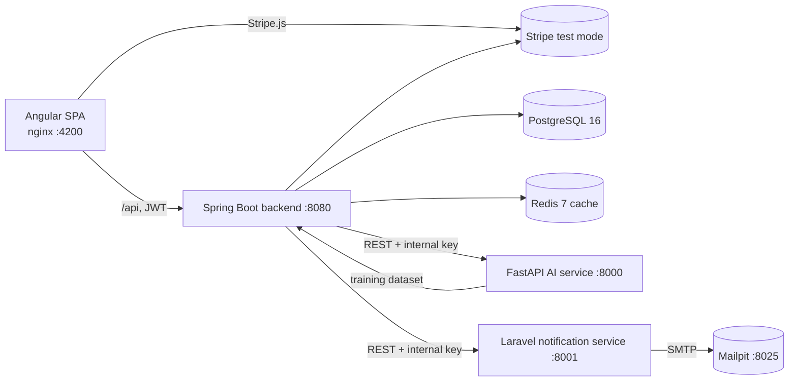

| Service | Stack | Folder |
|---|---|---|
| Backend | Java 21, Spring Boot 3.5, Spring Security + JWT (refresh-token rotation), Spring Data JPA, Flyway, MapStruct, Redis cache, springdoc OpenAPI, stripe-java | [`backend/`](backend) |
| Frontend | Angular 22 (standalone, zoneless, signals), Angular Material 3, Chart.js, Stripe.js | [`frontend/`](frontend) |
| AI | Python 3.11, FastAPI, scikit-learn, pandas | [`ai-service/`](ai-service) |
| Notifications & invoices | PHP 8.3, Laravel 13, dompdf | [`notification-service/`](notification-service) |
| Infra | Docker Compose, PostgreSQL, Redis, Mailpit, GitHub Actions | [`docker-compose.yml`](docker-compose.yml), [`.github/workflows`](.github/workflows) |

Key design decisions (multi-vendor order split, atomic stock reservation, async after-commit notifications, AI
fallbacks…) are explained in [`docs/architecture.md`](docs/architecture.md).

### The AI module

| Feature | Model | Where you see it |
|---|---|---|
| Recommendations | Hybrid: item-based collaborative filtering + TF-IDF content similarity + popularity prior | Customer home page, "Recommended for you" |
| Sales forecast | Ridge regression on log daily sales (trend, weekly and yearly seasonality), 80 % prediction band, validated against a seasonal-naive baseline | Seller dashboard |
| COD return risk | Logistic regression vs gradient boosting, selected by 5-fold CV ROC AUC (≈ 0.70 on the demo data) | Seller order list and order details (low / medium / high badge) |
| Description writer | Rule-based natural-language generation: extracts attributes (capacity, power, size, material, colour…) from the name and keywords, turns features into benefits, writes in a friendly, premium or technical tone. With `ANTHROPIC_API_KEY`, Claude (`claude-opus-5-5`, structured JSON output) writes the text instead; any reply that mentions a number the seller never gave is rejected and the rule-based writer is used | Seller product editor, "Write my product page" |
| Smart search | TF-IDF over words and character n-grams + truncated SVD (latent semantic analysis) + shopping-intent synonyms; falls back to the database's trigram search when the AI is down | Catalog "AI picks" for searches like "something to keep coffee hot" |
| Price suggestion | Similarity-weighted quartiles of the most similar products in the same category, rounded to a familiar price point | Seller product editor, "Suggest a price" |

The service trains on a synthetic dataset at build time (`python -m scripts.generate_dataset`,
`python -m scripts.train`), then retrains every hour from the live data exported by the backend. If it is down, the
marketplace keeps working: best sellers replace recommendations, the forecast says it is unavailable and orders have
no risk badge.

## Screenshots

| | |
|---|---|
| 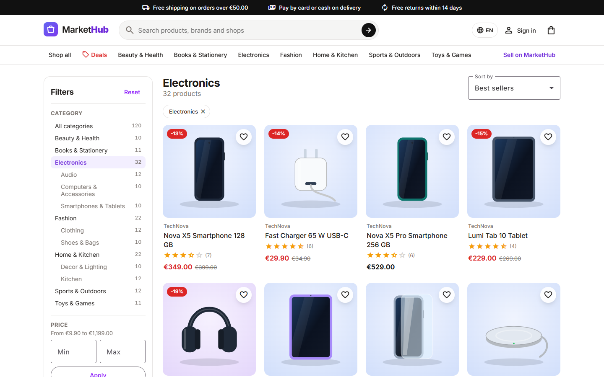 Catalog with filters | 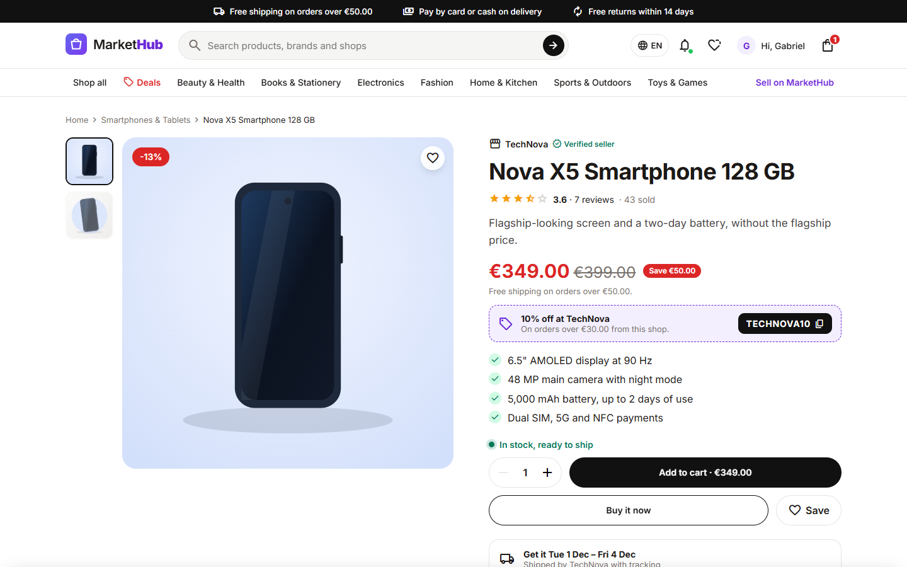 Product page |
| 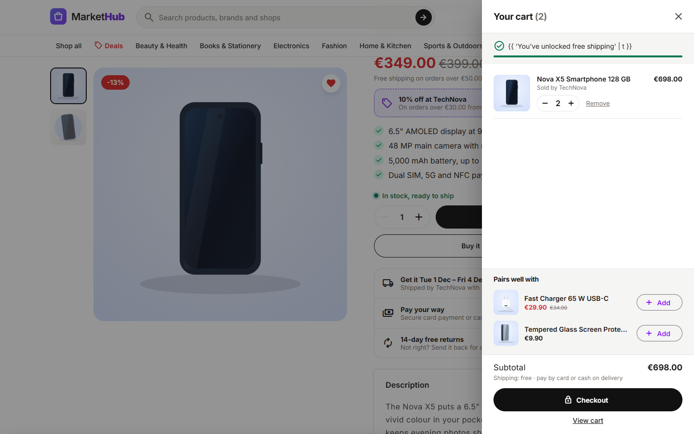 Cart drawer with free-shipping progress | 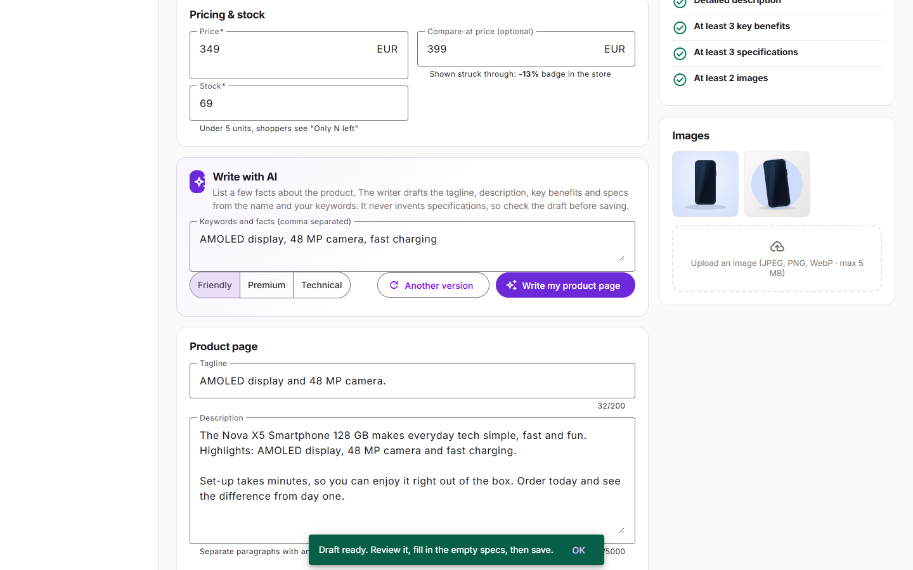 AI description writer and listing score |
|  AI recommendations | 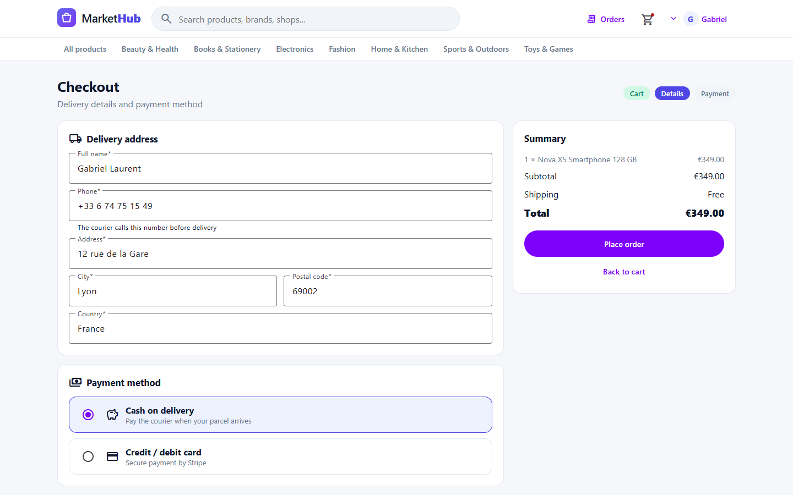 Checkout (COD or card) |
| 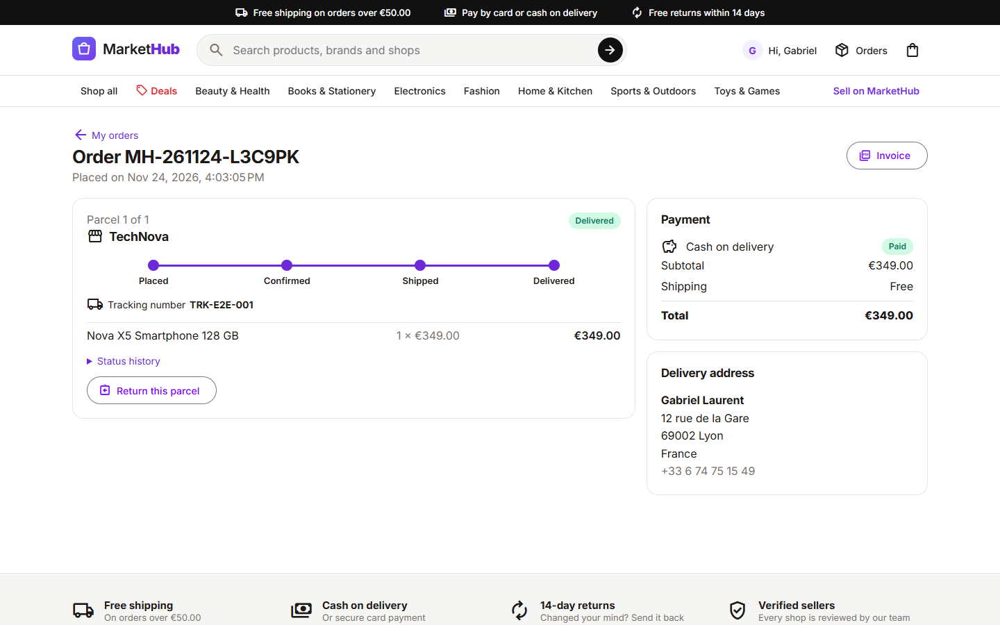 Parcel tracking | 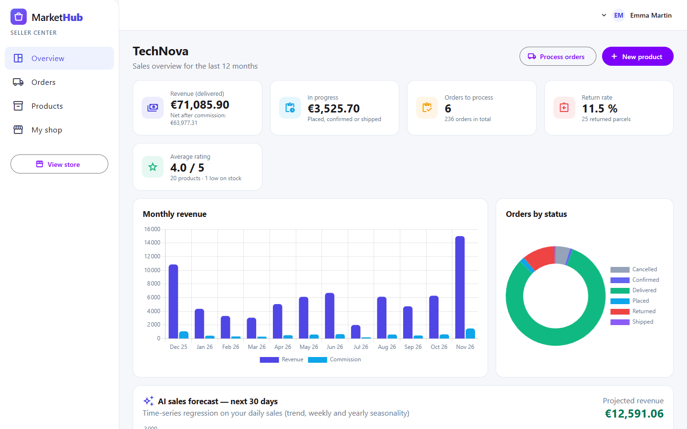 Seller dashboard with AI forecast |
| 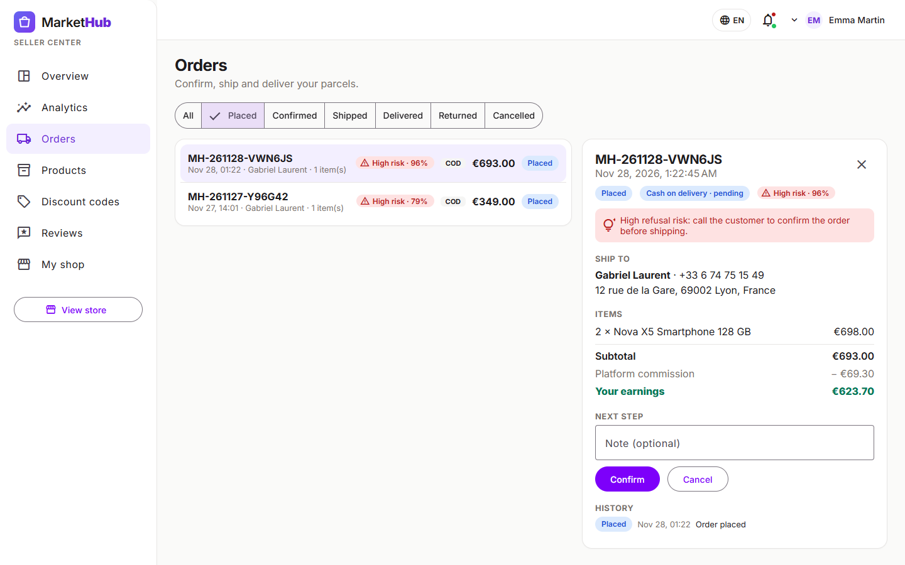 Order processing with risk badge | 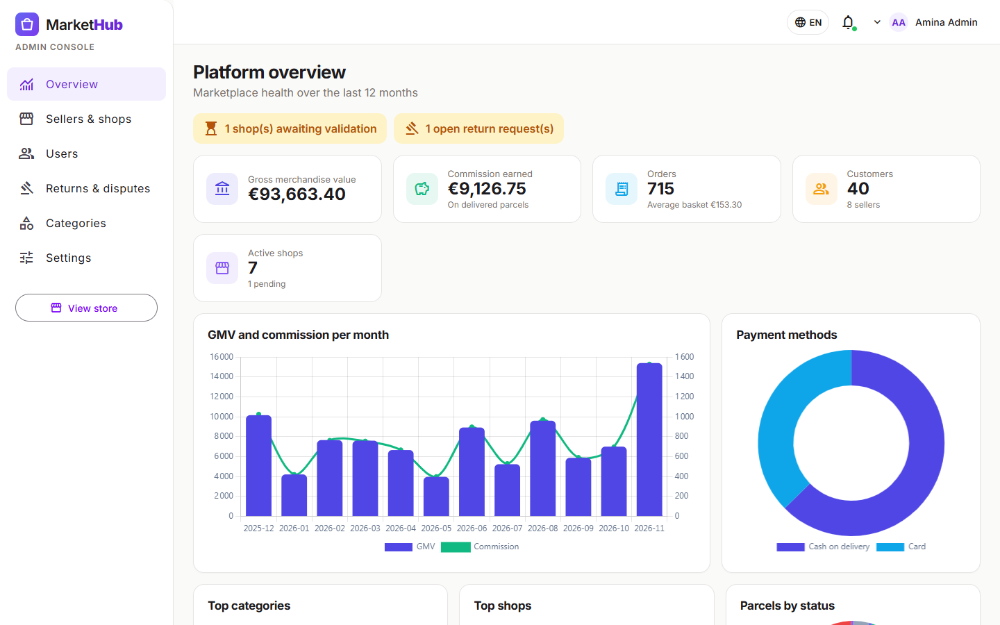 Admin console |
| 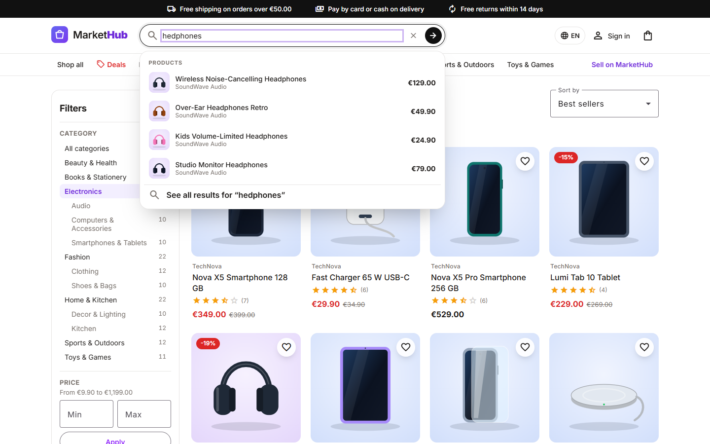 Instant, typo-tolerant search | 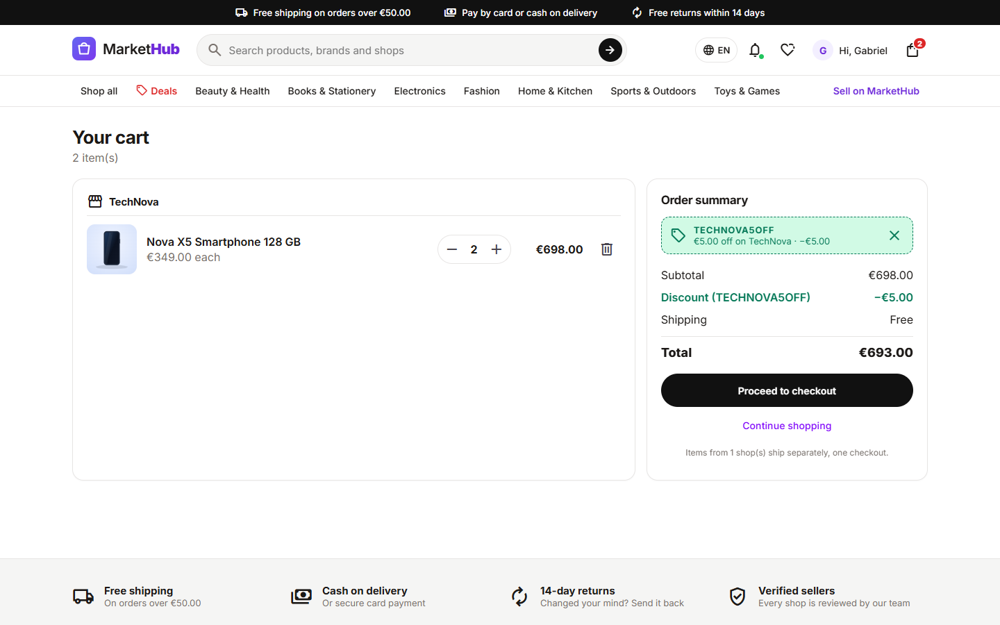 Discount code in the cart |
| 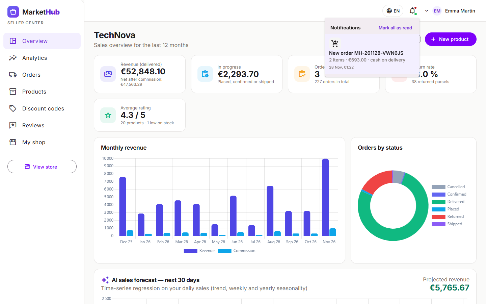 Live notification bell | 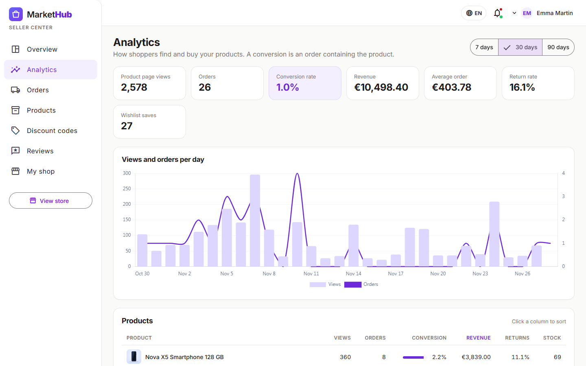 Seller conversion analytics |
| 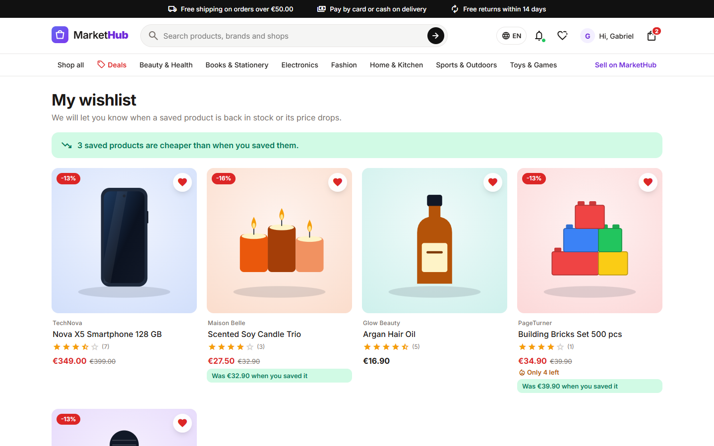 Wishlist with alerts | 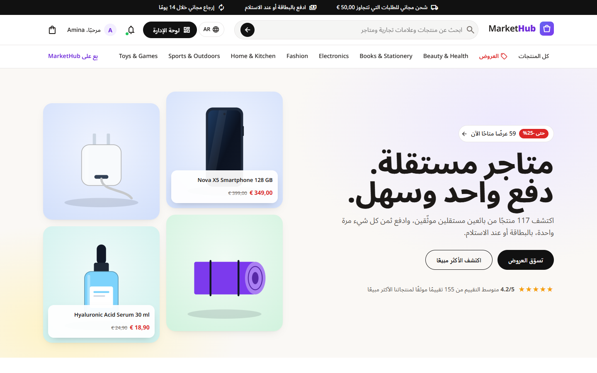 Arabic, right-to-left |

## Development

Each service runs on its own as well (see [`CLAUDE.md`](CLAUDE.md) for all commands).

```bash
# Backend without Docker: embedded PostgreSQL + demo data on :8080
cd backend && mvn spring-boot:test-run
# Frontend dev server on :4200 (proxies /api to :8080)
cd frontend && npm ci && npm start
# AI service on :8000
cd ai-service && pip install -r requirements-dev.txt && uvicorn app.main:app --port 8000
# Notification service on :8001
cd notification-service && composer install && cp .env.example .env && php artisan key:generate && php artisan serve --port=8001
```

## Tests

| Suite | Command | Tests |
|---|---|---|
| Backend (unit + PostgreSQL integration, coverage gate ≥ 70 % on services) | `cd backend && mvn verify` | 128 |
| Frontend | `cd frontend && npx ng test --watch=false` | 47 |
| AI service | `cd ai-service && pytest` | 35 |
| Notification service | `cd notification-service && php artisan test` | 11 |
| End-to-end journey (stack running) | `cd e2e && npm install && npm test` | 17 steps |

Backend line coverage: 89.9 % on services, 91.7 % overall. Full results and AI metrics:
[`docs/test-report.md`](docs/test-report.md). CI runs every suite and builds every Docker image.

## Documentation

| Document | Content |
|---|---|
| [`docs/architecture.md`](docs/architecture.md) | Components, decisions, order lifecycle, roadmap |
| [`docs/erd.md`](docs/erd.md) | Database schema (Mermaid ERD) and indexes |
| [`docs/uml.md`](docs/uml.md) | Use-case diagram and sequence diagrams (checkout, payment, fulfilment, AI, auth) |
| [`docs/api-contract.md`](docs/api-contract.md) | Every REST endpoint of the three services ([`openapi.json`](docs/openapi.json)) |
| [`docs/test-report.md`](docs/test-report.md) | Test results, coverage, AI evaluation |
| [`docs/deploy.md`](docs/deploy.md) | Going live for free on Oracle Cloud with one command ([`deploy/setup-server.sh`](deploy/setup-server.sh)), any Docker server, or the Render Blueprint ([`render.yaml`](render.yaml)) |

## Project structure

```
backend/                Spring Boot API (package by feature: auth, catalog, cart, order, payment, ai, …)
frontend/               Angular SPA (core/, shared/, layout/, features/store|seller|admin)
ai-service/             FastAPI app (app/ml), dataset generator and training scripts, tests
notification-service/   Laravel API: order e-mails and PDF invoices
e2e/                    Browser end-to-end journey (also produces the screenshots)
docs/                   Architecture, ERD, UML, API contract, test report, deployment, screenshots
monitoring/             Prometheus scrape config and the provisioned Grafana dashboard
scripts/                Tooling (API contract export)
docker-compose.yml      The whole platform
```
