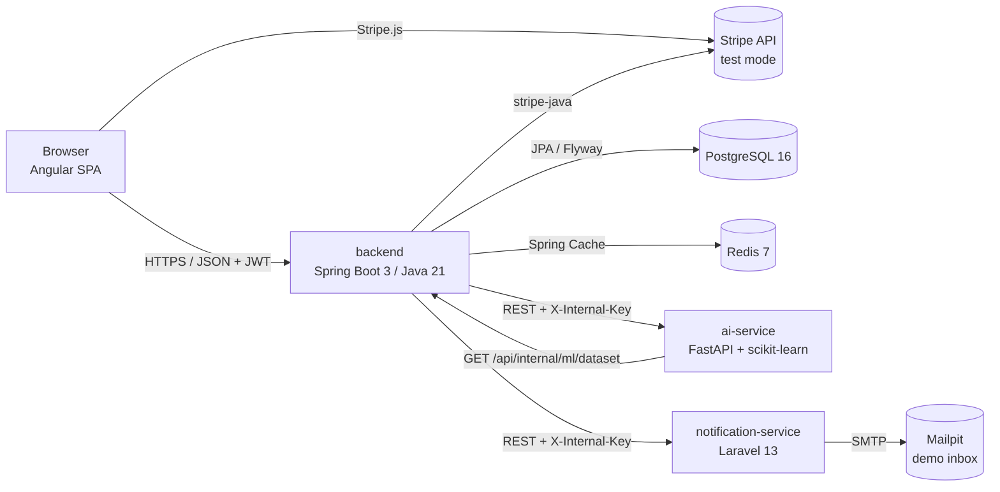
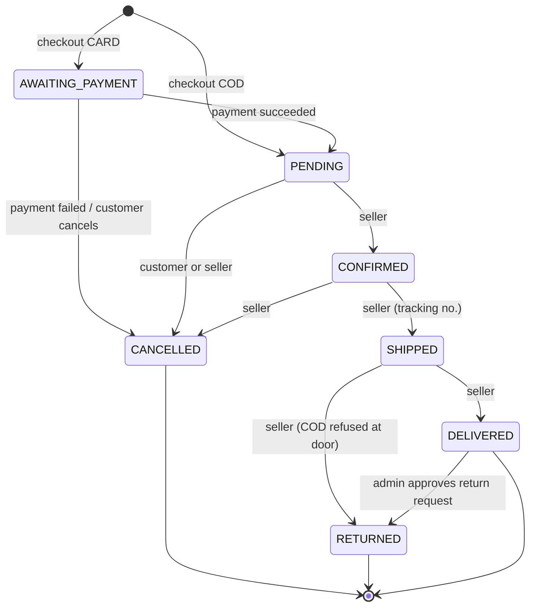

# MarketHub — Architecture

MarketHub is a multi-vendor marketplace: customers buy products from many shops, sellers manage their
shop, admins supervise the platform. Payment is cash on delivery (COD) or card (Stripe, test mode).
An AI microservice provides recommendations, sales forecasts and a COD return-risk score.

## 1. Components



| Service | Tech | Port | Responsibility |
|---|---|---|---|
| `frontend` | Angular 22, Angular Material 3, Chart.js | 4200 | Storefront, seller dashboard, admin dashboard |
| `backend` | Spring Boot 3.5, Spring Security, JPA, Flyway, MapStruct | 8080 | Business API, auth, orders, payments, orchestration |
| `ai-service` | Python 3.11, FastAPI, scikit-learn, pandas | 8000 | Recommendations, sales forecast, return-risk, product description writer |
| `notification-service` | PHP 8.3, Laravel 13, dompdf | 8001 | Order emails, PDF invoices |
| `postgres` | PostgreSQL 16 | 5432 | Main database |
| `redis` | Redis 7 | 6379 | Catalog / category / recommendation cache |
| `mailpit` | Mailpit | 8025 (UI), 1025 (SMTP) | Captures every email for the demo |

## 2. Key architecture decisions

| # | Decision | Why |
|---|---|---|
| 1 | **Order split into `orders` + `shop_orders`.** One checkout = one customer order (one payment), split into one sub-order per shop. Sellers only see and process their sub-order. | A real multi-vendor cart contains items from several shops; each seller ships independently. |
| 2 | **Stock reserved at checkout** with a conditional `UPDATE … WHERE stock >= qty`; restored on cancel/return. | Prevents overselling under concurrency without pessimistic locks. |
| 3 | **JWT access token (15 min) + opaque refresh token (7 days) stored hashed in PostgreSQL**, rotated on every refresh. | Revocable sessions (logout, disabled user) with a durable store; Redis is kept for cache only. |
| 4 | **Redis = Spring Cache** for categories, product pages and recommendations. `spring.cache.type=simple` when Redis is absent (tests, local). | Fast catalog reads; the app never depends on Redis to be correct. |
| 5 | **Notifications are asynchronous** (`@TransactionalEventListener(AFTER_COMMIT)` + `@Async`). | An email outage must never roll back or slow down an order. |
| 6 | **Stripe has a mock mode.** Without `STRIPE_SECRET_KEY`, the backend issues a simulated payment intent and the UI shows a simulated card form. | The jury demo works with zero external accounts; with test keys the real Stripe Payment Element is used. |
| 7 | **AI is optional at runtime.** Backend calls AI with a short timeout and falls back (popular products, no forecast, no risk badge). | The marketplace keeps working if the AI service is down. |
| 8 | **AI training data comes from the backend over REST** (`/api/internal/ml/dataset`, internal key). A synthetic dataset generator is used for offline training and tests. | Services only talk over REST; models stay consistent with the real catalog. |
| 9 | **Forecasting is stateless**: the backend sends a shop's daily revenue history, the AI service fits and returns the forecast. | No data duplication; forecast always reflects live data. |
| 10 | **Integration tests run on PostgreSQL** via Testcontainers; when Docker is missing they fall back to an embedded PostgreSQL binary (zonky). | Same SQL dialect as production everywhere; tests run on a laptop without Docker and in CI. |
| 11 | **Angular unit tests use Vitest**, the default runner of Angular 22 (Jest/Jasmine-compatible `describe/it/expect`). | Official tooling, no extra Karma/Jest setup to maintain. |
| 12 | **Tokens stored in localStorage** (15-min access token, rotating refresh token). | Simple for a SPA calling a separate API; XSS exposure limited by Angular sanitization and short lifetimes. |
| 13 | **Merchandising content is part of the product** (V2): `compare_at_price` (sale), `tagline`, `highlights` and `specs` stored as JSONB lists. | One read per product page, no extra tables to join; the lists are small, always loaded together and validated by the API (≤ 8 benefits, ≤ 20 specs). |
| 14 | **"Frequently bought together" is computed from real orders** (products in at least 2 of the same checkouts), padded with similar best sellers. | Data-driven cross-selling with no extra model; the minimum support of 2 keeps one-off coincidences out. |
| 15 | **The AI description writer is rule-based NLG that never invents facts.** It extracts attributes (capacity, power, size, material…) from the name and the seller's keywords and writes in a chosen tone; specs it cannot read are only suggested as empty labels. | Sellers get a complete page in one click while every claim stays theirs: invented specs would cause returns and legal risk. No external LLM account is needed for the demo. |
| 16 | **Conversion patterns on the storefront**: cart drawer with free-shipping progress and pairings, sale badges, stock urgency only from real stock, delivery window, verified-purchase reviews, sticky buy bar, recently viewed (browser storage). | Each pattern answers a buying objection (cost, trust, timing) using real data only: no fake countdowns or fake scarcity. |

## 3. Backend layering

```
controller  →  service  →  repository
   ↑  DTO (records, jakarta.validation)
   └─ mapper (MapStruct)  ↔  entity (JPA)
```

- Controllers only translate HTTP ↔ DTO and delegate.
- Services hold business rules and transactions.
- `GlobalExceptionHandler` maps exceptions to RFC 7807 `ProblemDetail` responses.
- Package by feature: `auth`, `user`, `shop`, `catalog`, `cart`, `order`, `payment`, `review`, `dispute`, `stats`, `ai`, `notification`, `admin`, `common`, `config`, `security`.

## 4. Order lifecycle (per shop order)



Emails are sent on: order placed (with PDF invoice), shipped, delivered, cancelled, returned.

## 5. Main REST endpoints (backend, prefix `/api`)

Full contract: Swagger UI at `http://localhost:8080/swagger-ui.html`, exported to `docs/api-contract.md`.

| Area | Endpoints |
|---|---|
| Auth | `POST /auth/register`, `POST /auth/login`, `POST /auth/refresh`, `POST /auth/logout`, `GET /auth/me` |
| Catalog (public) | `GET /products` (q, categoryId, shopId, minPrice, maxPrice, minRating, inStock, onSale, sort, page, size), `GET /products/{id}`, `GET /products/{id}/similar`, `GET /products/{id}/bought-together`, `GET /categories`, `GET /shops/{slug}` |
| Reviews | `GET /products/{id}/reviews`, `POST /products/{id}/reviews` (customer who received the product) |
| Cart | `GET /cart`, `POST /cart/items`, `PUT /cart/items/{productId}`, `DELETE /cart/items/{productId}`, `DELETE /cart` |
| Orders | `POST /orders/checkout`, `GET /orders`, `GET /orders/{id}`, `POST /orders/{id}/cancel`, `GET /orders/{id}/invoice`, `POST /orders/shop-orders/{id}/return-request` |
| Payments | `POST /payments/{orderId}/confirm`, `POST /payments/stripe/webhook` |
| Recommendations | `GET /recommendations` |
| Seller | `GET/PUT /seller/shop`, `GET/POST/PUT/DELETE /seller/products`, `POST /seller/products/describe` (AI writer), `POST /seller/products/{id}/images`, `PATCH /seller/products/{id}/stock`, `GET /seller/orders`, `PATCH /seller/orders/{id}/status`, `GET /seller/stats`, `GET /seller/forecast` |
| Admin | `GET /admin/users`, `PATCH /admin/users/{id}/enabled`, `GET /admin/shops`, `PATCH /admin/shops/{id}/status`, `PATCH /admin/shops/{id}/commission`, `POST/PUT/DELETE /admin/categories`, `GET/PUT /admin/settings`, `GET /admin/stats`, `GET /admin/disputes`, `PATCH /admin/disputes/{id}` |
| Internal | `GET /internal/ml/dataset` (header `X-Internal-Key`) |

AI service: `POST /recommendations`, `POST /forecast`, `POST /return-risk`, `POST /copywriter`, `POST /train`, `GET /health`.
Notification service: `POST /api/notifications/order-event`, `POST /api/invoices`, `GET /api/health`.

## 6. Roadmap

| Phase | Content | Done when |
|---|---|---|
| 0 | Architecture, ERD, conventions (`CLAUDE.md`) | Docs reviewed |
| 1 | Monorepo, docker-compose (Postgres, Redis), Spring Boot base, Flyway, auth + JWT + roles | `mvn verify` green |
| 2 | Categories, products, images, cart, checkout, stock, shop orders, seller & admin management | Service tests ≥ 70 % |
| 3 | Angular storefront → seller dashboard → admin dashboard | `ng build` + unit tests green |
| 4 | Laravel notifications + PDF invoices, Stripe test mode, COD flow | Emails visible in Mailpit |
| 5 | AI service, dataset generator, training, backend + UI integration | `pytest` green, UI shows AI blocks |
| 6 | E2E journey test, demo seed, README, Swagger export, CI | `docker compose up` = full demo |
| 7 | Conversion-focused storefront redesign, rich product content (V2), deals, bundles, cart drawer, AI description writer, listing quality score, illustrated demo catalog | E2E journey (10 steps) green, all suites green |
