# Database schema (ERD)

Source of truth: Flyway migrations in `backend/src/main/resources/db/migration`.

```mermaid
erDiagram
    USERS ||--o{ REFRESH_TOKENS : has
    USERS ||--o| SHOPS : owns
    USERS ||--o{ CART_ITEMS : fills
    USERS ||--o{ ORDERS : places
    USERS ||--o{ REVIEWS : writes
    USERS ||--o{ DISPUTES : opens
    CATEGORIES ||--o{ CATEGORIES : parent
    CATEGORIES ||--o{ PRODUCTS : classifies
    SHOPS ||--o{ PRODUCTS : sells
    SHOPS ||--o{ SHOP_ORDERS : fulfils
    PRODUCTS ||--o{ PRODUCT_IMAGES : shows
    PRODUCTS ||--o{ CART_ITEMS : "is in"
    PRODUCTS ||--o{ ORDER_ITEMS : "is sold as"
    PRODUCTS ||--o{ REVIEWS : receives
    ORDERS ||--|{ SHOP_ORDERS : "split into"
    ORDERS ||--o{ PAYMENTS : "paid by"
    SHOP_ORDERS ||--|{ ORDER_ITEMS : contains
    SHOP_ORDERS ||--o{ ORDER_STATUS_HISTORY : tracks
    SHOP_ORDERS ||--o{ DISPUTES : "subject of"
    SHOPS ||--o{ COUPONS : offers
    COUPONS ||--o{ SHOP_ORDERS : "used on"
    USERS ||--o{ WISHLIST_ITEMS : saves
    PRODUCTS ||--o{ WISHLIST_ITEMS : "saved as"
    USERS ||--o{ USER_NOTIFICATIONS : receives
    REVIEWS ||--o{ REVIEW_VOTES : "voted helpful"
    USERS ||--o{ REVIEW_VOTES : casts
    PRODUCTS ||--o{ PRODUCT_VIEWS : "viewed per day"

    USERS {
        bigint id PK
        varchar email UK
        varchar password_hash
        varchar first_name
        varchar last_name
        varchar phone
        varchar role "CUSTOMER | SELLER | ADMIN"
        boolean enabled
        int failed_login_count "V7"
        timestamptz locked_until "V7"
        varchar totp_secret "V7, AES-GCM encrypted"
        boolean totp_enabled "V7"
        timestamptz cart_reminder_sent_at "V4"
        timestamptz created_at
        timestamptz updated_at
    }
    REFRESH_TOKENS {
        bigint id PK
        bigint user_id FK
        varchar token_hash UK "SHA-256"
        timestamptz expires_at
        boolean revoked
        timestamptz created_at
    }
    SHOPS {
        bigint id PK
        bigint owner_id FK,UK
        varchar name
        varchar slug UK
        text description
        varchar status "PENDING | APPROVED | REJECTED | SUSPENDED"
        numeric commission_rate "nullable override, percent"
        timestamptz created_at
        timestamptz updated_at
    }
    CATEGORIES {
        bigint id PK
        bigint parent_id FK
        varchar name
        varchar slug UK
        text description
    }
    PRODUCTS {
        bigint id PK
        bigint shop_id FK
        bigint category_id FK
        varchar name
        varchar tagline
        text description
        jsonb highlights "key benefits"
        jsonb specs "label/value list"
        numeric price
        numeric compare_at_price "CHECK > price, sale"
        int stock "CHECK >= 0"
        boolean active
        numeric avg_rating
        int review_count
        int sold_count
        bigint version
        timestamptz created_at
        timestamptz updated_at
    }
    PRODUCT_IMAGES {
        bigint id PK
        bigint product_id FK
        varchar url
        int position
    }
    CART_ITEMS {
        bigint id PK
        bigint user_id FK
        bigint product_id FK
        int quantity
        timestamptz added_at
    }
    ORDERS {
        bigint id PK
        varchar reference UK
        bigint customer_id FK
        varchar payment_method "COD | CARD"
        varchar payment_status "PENDING | PAID | FAILED | REFUNDED"
        numeric subtotal
        numeric discount_total "V3"
        numeric shipping_fee
        numeric total
        varchar shipping_full_name
        varchar shipping_phone
        varchar shipping_address_line
        varchar shipping_city
        varchar shipping_postal_code
        varchar shipping_country
        numeric return_risk_score "0..1, COD only"
        timestamptz created_at
        timestamptz updated_at
    }
    SHOP_ORDERS {
        bigint id PK
        bigint order_id FK
        bigint shop_id FK
        varchar status
        numeric subtotal "net of discount"
        bigint coupon_id FK "V3"
        varchar coupon_code "V3, snapshot"
        numeric discount_amount "V3"
        numeric commission_rate
        numeric commission_amount
        varchar tracking_number
        timestamptz created_at
        timestamptz updated_at
    }
    ORDER_ITEMS {
        bigint id PK
        bigint shop_order_id FK
        bigint product_id FK
        varchar product_name "snapshot"
        numeric unit_price "snapshot"
        int quantity
        numeric line_total
    }
    ORDER_STATUS_HISTORY {
        bigint id PK
        bigint shop_order_id FK
        varchar status
        varchar note
        bigint changed_by FK
        timestamptz changed_at
    }
    PAYMENTS {
        bigint id PK
        bigint order_id FK
        varchar provider "STRIPE | STRIPE_MOCK | COD"
        varchar provider_reference
        numeric amount
        varchar currency
        varchar status
        timestamptz created_at
        timestamptz updated_at
    }
    REVIEWS {
        bigint id PK
        bigint product_id FK
        bigint user_id FK
        smallint rating "1..5"
        text comment
        int helpful_count "V5"
        jsonb photo_urls "V5"
        text seller_reply "V5"
        timestamptz seller_replied_at "V5"
        timestamptz created_at
    }
    REVIEW_VOTES {
        bigint review_id PK,FK
        bigint user_id PK,FK
        timestamptz created_at
    }
    COUPONS {
        bigint id PK
        bigint shop_id FK
        varchar code UK
        varchar type "PERCENT | FIXED"
        numeric value
        numeric min_subtotal
        timestamptz starts_at
        timestamptz ends_at
        int max_uses
        int used_count
        boolean once_per_customer
        boolean featured
        boolean active
    }
    WISHLIST_ITEMS {
        bigint id PK
        bigint user_id FK
        bigint product_id FK
        numeric price_when_added
        numeric last_alert_price
        timestamptz created_at
    }
    USER_NOTIFICATIONS {
        bigint id PK
        bigint user_id FK
        varchar type
        varchar title
        varchar body
        varchar link
        timestamptz read_at
        timestamptz created_at
    }
    PRODUCT_VIEWS {
        bigint product_id PK,FK
        date day PK
        int views
    }
    DISPUTES {
        bigint id PK
        bigint shop_order_id FK
        bigint customer_id FK
        varchar type "RETURN | DISPUTE"
        varchar reason
        varchar status "OPEN | APPROVED | REJECTED"
        varchar admin_note
        timestamptz created_at
        timestamptz resolved_at
    }
    PLATFORM_SETTINGS {
        varchar key PK
        varchar value
    }
```

## Indexes (besides PK / UK)

| Table | Index | Purpose |
|---|---|---|
| products | `(category_id)`, `(shop_id)`, `(active, created_at)`, `(price)`, `lower(name)` | Catalog filters and sorting |
| products | `(sold_count desc) where compare_at_price is not null` (V2) | Deals listing |
| products | GIN `lower(name) gin_trgm_ops` (V6) | Typo-tolerant search and suggestions |
| coupons | unique `(code)`, `(shop_id)`; shop_orders `(coupon_id)` (V3) | Code lookup, seller list, once-per-customer check |
| wishlist_items | unique `(user_id, product_id)`, `(product_id)` (V4) | One save per product, alerts fan-out |
| user_notifications | `(user_id, created_at desc)`, partial `(user_id) where read_at is null` (V4) | Bell list and unread count |
| reviews | `(product_id, helpful_count desc, created_at desc)` (V5) | "Most helpful" sort |
| product_views | PK `(product_id, day)`, `(day)` (V6) | Daily upsert and period analytics |
| cart_items | unique `(user_id, product_id)` | One line per product |
| orders | `(customer_id, created_at desc)` | Order history |
| shop_orders | `(shop_id, status)`, `(order_id)` | Seller inbox |
| order_items | `(shop_order_id)`, `(product_id)` | Joins, recommendations export |
| reviews | unique `(product_id, user_id)` | One review per customer per product |
| disputes | `(status)` | Admin inbox |
| refresh_tokens | `(user_id)` | Revoke all on logout/disable |
