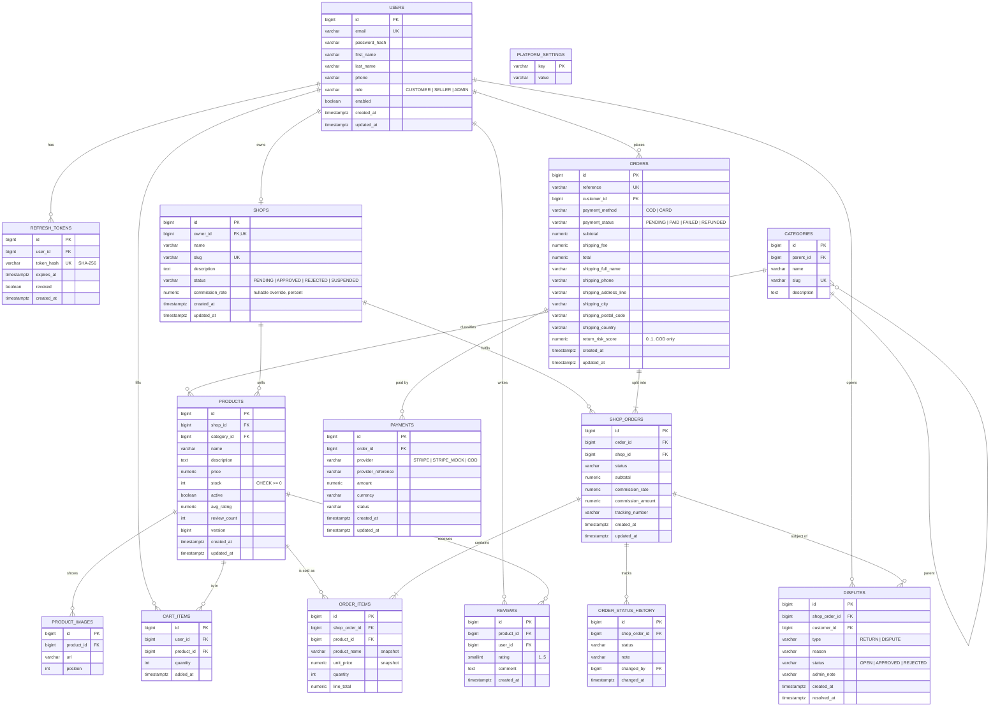

# Database schema (ERD)

Source of truth: Flyway migrations in `backend/src/main/resources/db/migration`.

## Indexes (besides PK / UK)

| Table | Index | Purpose |
|---|---|---|
| products | `(category_id)`, `(shop_id)`, `(active, created_at)`, `(price)`, `lower(name)` | Catalog filters and sorting |
| cart_items | unique `(user_id, product_id)` | One line per product |
| orders | `(customer_id, created_at desc)` | Order history |
| shop_orders | `(shop_id, status)`, `(order_id)` | Seller inbox |
| order_items | `(shop_order_id)`, `(product_id)` | Joins, recommendations export |
| reviews | unique `(product_id, user_id)` | One review per customer per product |
| disputes | `(status)` | Admin inbox |
| refresh_tokens | `(user_id)` | Revoke all on logout/disable |
