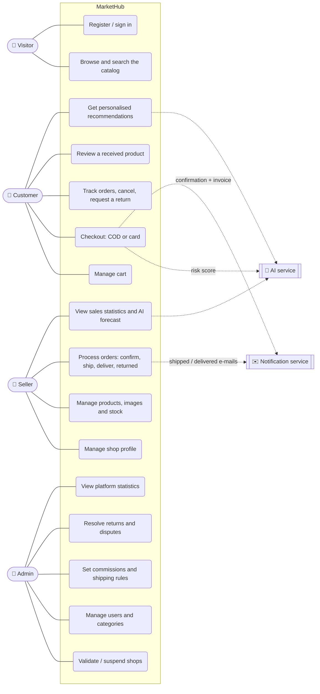
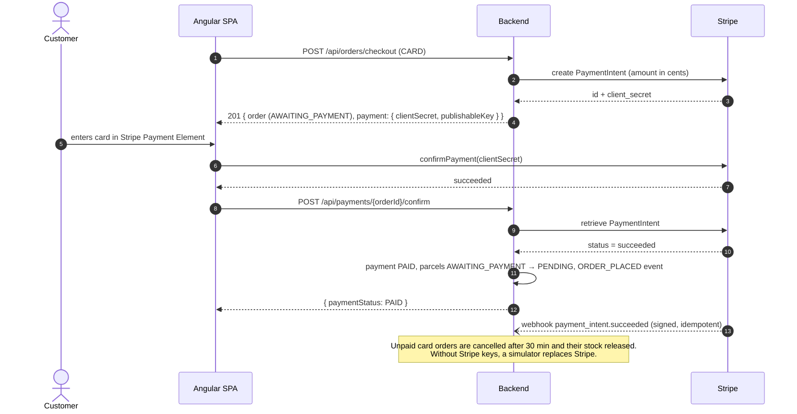
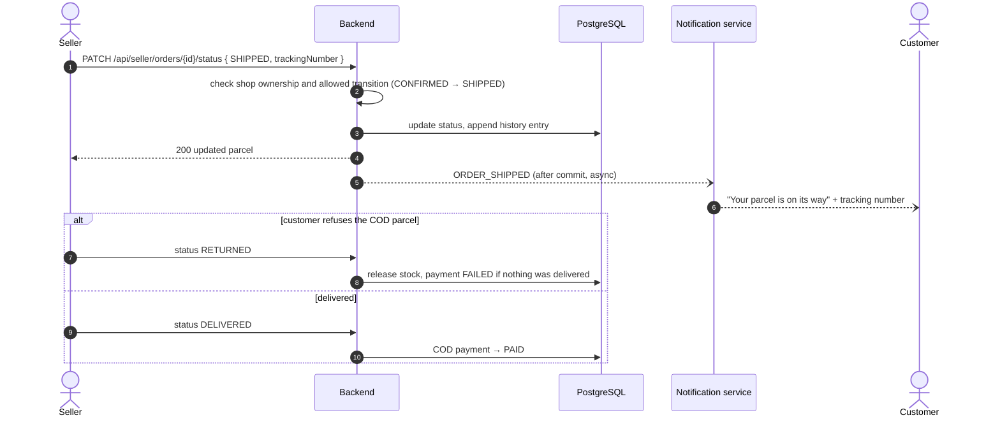
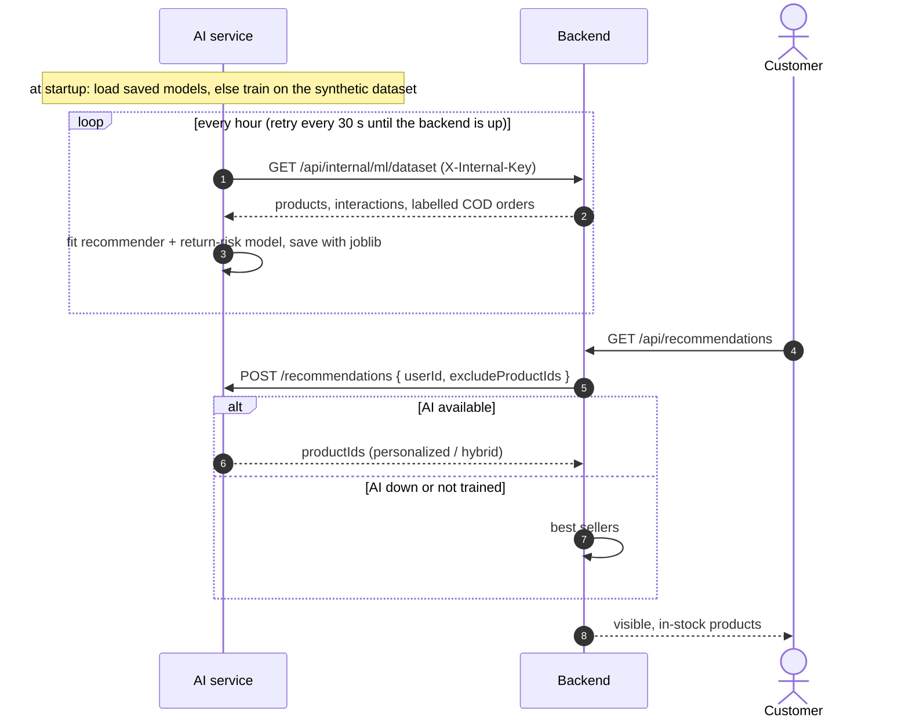
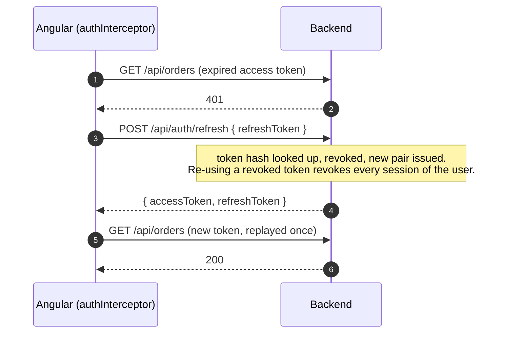

# UML diagrams

All diagrams are Mermaid (rendered by GitHub, GitLab and most Markdown viewers).

## 1. Use cases

Mermaid has no native use-case notation; actors are on the sides and use cases are the rounded nodes.



## 2. Sequence — cash-on-delivery checkout

```mermaid
sequenceDiagram
    autonumber
    actor C as Customer
    participant UI as Angular SPA
    participant API as Backend
    participant DB as PostgreSQL
    participant AI as AI service
    participant NS as Notification service

    C->>UI: Place order (COD)
    UI->>API: POST /api/orders/checkout
    API->>DB: load cart with products and shops
    loop each cart line
        API->>DB: UPDATE products SET stock = stock - qty WHERE stock >= qty
        DB-->>API: 1 row (or 0 → 422 "not enough stock", transaction rolled back)
    end
    API->>API: split into one shop order per seller, snapshot prices and commission
    API->>AI: POST /return-risk (features of the order and customer history)
    AI-->>API: { score: 0.23, level: "medium" }
    API->>DB: INSERT order, shop orders, items, history; DELETE cart
    API-->>UI: 201 { order }
    Note over API,NS: after commit, on a background thread
    API->>NS: POST /api/notifications/order-event (ORDER_PLACED)
    NS->>NS: render PDF invoice (dompdf)
    NS-->>C: confirmation e-mail with invoice
```

## 3. Sequence — card payment (Stripe test mode)



## 4. Sequence — seller processes a parcel



## 5. Sequence — AI training and recommendations



## 6. Sequence — token refresh


